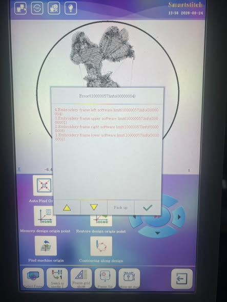
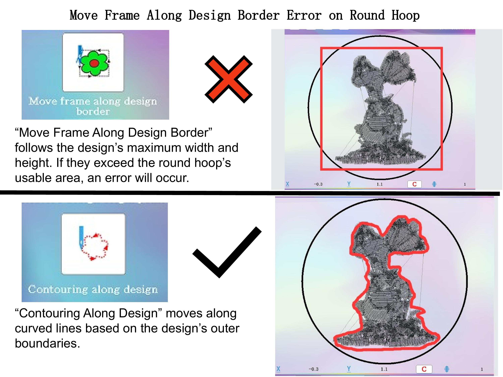

# Move Frame Along Design Border Error on Round Hoop

## Overview

When using a round embroidery hoop, the machine may display an error when using **Move Frame Along Design Border**.

This does not necessarily mean there is a problem with the machine. The error can occur because the design dimensions exceed the usable embroidery area of the round hoop.

## Move Frame Along Design Border

**Move Frame Along Design Border** follows the design's maximum width and height.

The machine checks the outermost points of the design based on its overall width and height. If the maximum width or height exceeds the usable area of the round hoop, the machine may report an error.

### Important

The physical diameter of the round hoop is not the same as the actual usable embroidery area.

Always check the machine's specified embroidery area for the selected hoop.

## Contouring Along Design

**Contouring Along Design** moves along curved lines based on the design's outer boundaries.

Unlike **Move Frame Along Design Border**, this function follows the contour or curved shape of the design rather than simply using the maximum width and height.

## Key Difference

| Function | Movement Method |
|---|---|
| Move Frame Along Design Border | Based on the design's maximum width and height |
| Contouring Along Design | Follows the design's outer curved boundaries |

## Example

A design may fit inside the round hoop when considering its actual curved shape, but its maximum width or height may still exceed the machine's calculated usable area.

In this situation:

**Move Frame Along Design Border → Error**

while:

**Contouring Along Design → May work normally**

## Troubleshooting

If you receive an error:

1. Check the selected hoop size.
2. Confirm that the correct hoop type is selected on the machine.
3. Check the design's maximum width and height.
4. Compare the design dimensions with the hoop's usable embroidery area.
5. Make sure the design is properly centered.
6. If necessary, reduce the design size while keeping it within the recommended scaling range.

## Conclusion

The key point is that **Move Frame Along Design Border** is based on the design's maximum width and height, while **Contouring Along Design** follows the design's outer contour.

Understanding the difference between these two functions can help prevent unnecessary hoop errors when working with round hoops.