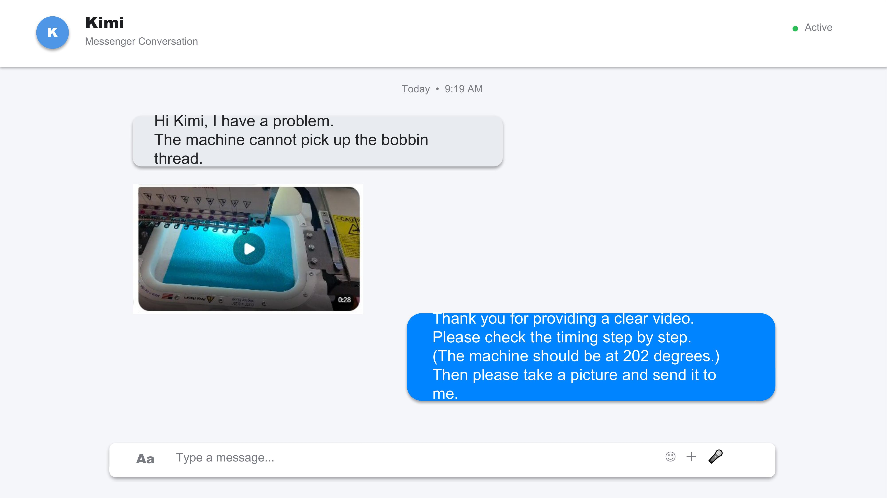
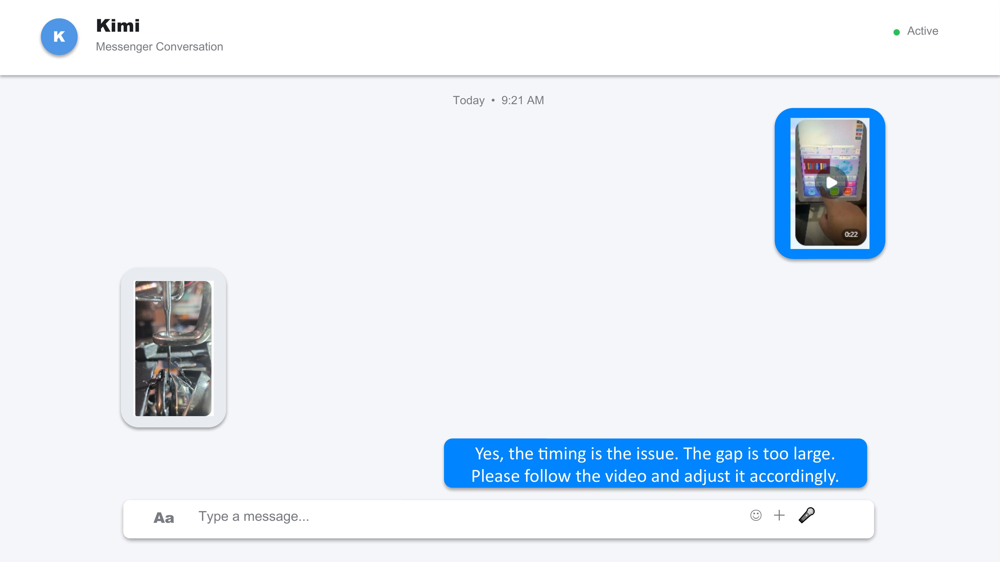
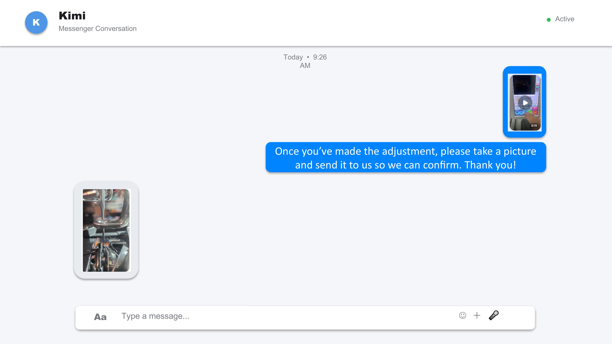
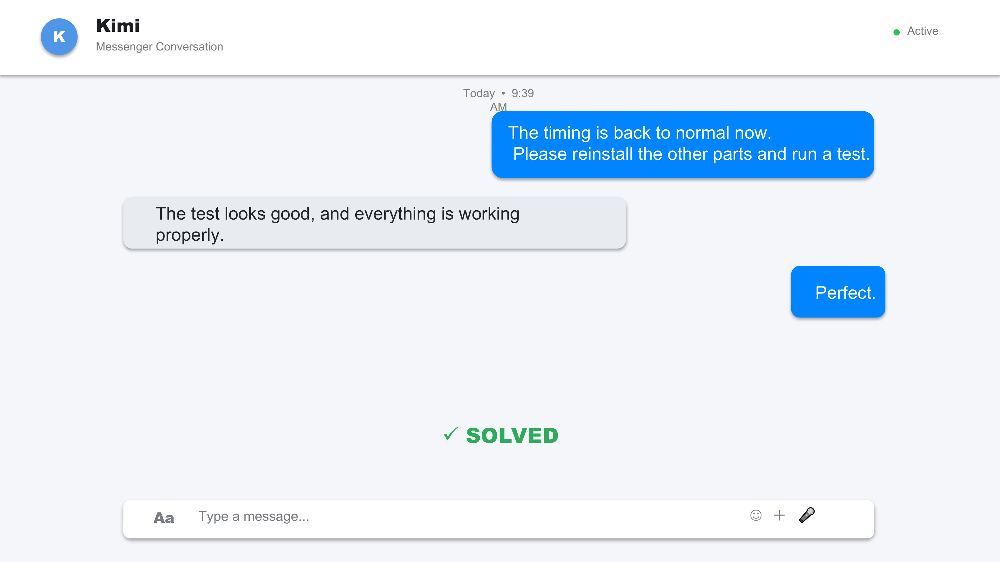
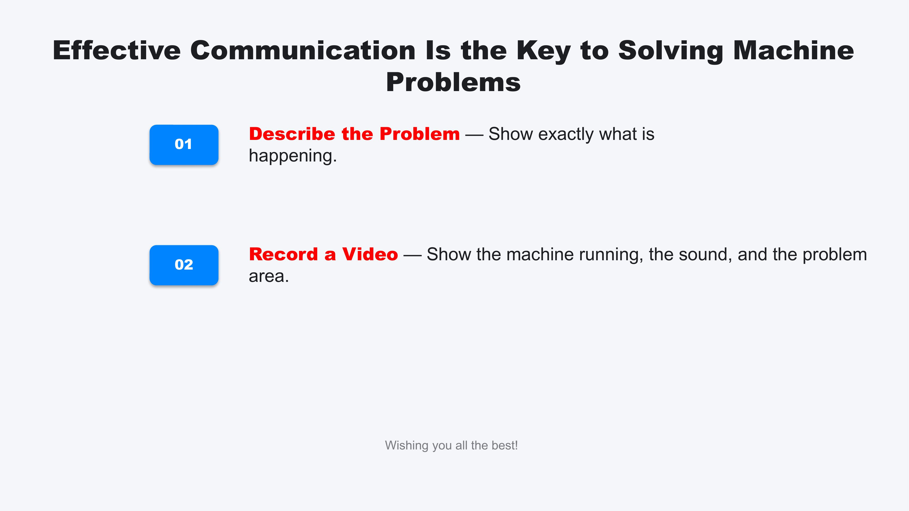

# Reporting Machine Issues Effectively

## Overview

If your embroidery machine exhibits unusual behavior, error messages, or performance problems, you can use the following two‑step method to help our technicians understand the issue quickly and accurately.

## Problem Description

Briefly explain what is happening, when the problem started, and under which conditions it occurs (e.g., during startup, while changing thread, at a specific stitch count, or after a particular operation).

- **Provide a clear written summary** – mention any error codes, unusual noises, or repeated steps that trigger the fault.
- **Include relevant details** – such as machine model, thread type, fabric, and hoop size.

## Important

A well‑lit, focused video of the machine running is extremely helpful. Show the control panel, the moving parts, and the exact area where the issue appears. Avoid vague descriptions like “it doesn’t work” – instead, note exactly what you see and hear.

Combining a precise written explanation with a short video clip significantly reduces diagnostic time and helps us get your machine back to normal as quickly as possible.

## Conclusion

Clear information and visual evidence are the keys to effective troubleshooting. By following these two simple steps, you enable our support team to identify and resolve the problem faster. 👍

