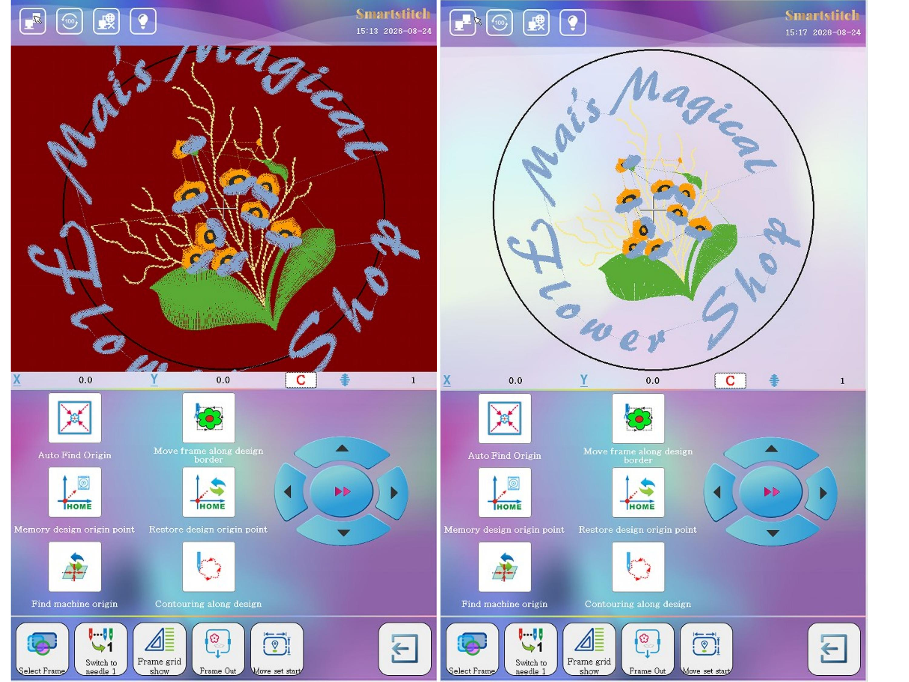
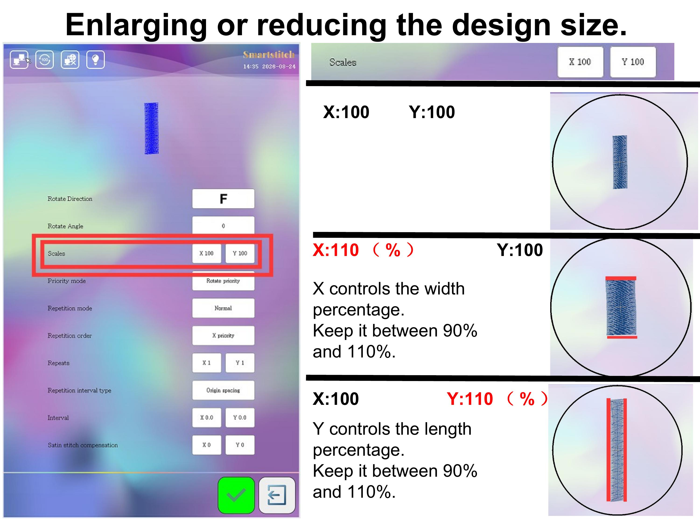

# Resizing Embroidery Designs

## Overview

If an embroidery design does not fit inside the hoop, you can use the resize function to enlarge or reduce the design size.

## Scaling Control

Keep the scaling range between **90% and 110%**.

- **X controls the width percentage.** Keep it between 90% and 110%.
- **Y controls the length percentage.** Keep it between 90% and 110%.

## Important

Adjust X and Y carefully to maintain the correct design proportions.

Avoid excessive scaling, as it may affect stitch quality and the final embroidery result.

## Conclusion

The resize function helps make a design fit the selected hoop. For best results, keep X and Y scaling between **90% and 110%**.